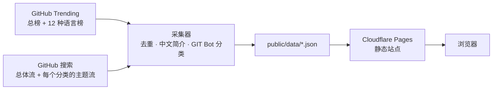

<div align="center">


# GIT Bot

**用中文发现 GitHub 上正在升温的开源项目——不只是 AI，还有工具和生活。**

[在线体验](https://radar.chenran71ran.cc/) · [亮点](#亮点) · [GIT Bot 分类](#git-bot-分类) · [工作原理](#工作原理) · [快速开始](#快速开始) · [文档](#文档)

<!-- SCREENSHOTS -->

</div>

## 为什么做它

GitHub Trending 每页只有十几个项目，几乎都是 AI，全是英文，也看不出一个项目到底拿来干什么。想找一个好用的记账工具、一个自托管相册、一个健身 App，Trending 帮不上忙。

GIT Bot 每天从更多地方收集正在升温的项目，给每个项目配上中文简介，按「它是拿来做什么的」分好类，并告诉你为什么这样分。

## 亮点

**更广的发现范围**
除了 Trending 总榜，还收集 12 种编程语言各自的榜单，以及 GitHub 搜索到的近期新建、Star 涨得快的项目；23 个分类各有自己的搜索流，专门找出工具类、生活类这些很少登上总榜的项目。<!-- SCALE -->

**GIT Bot 分类引擎**
4 个领域、23 个细类。综合 GitHub 主题、简介、README、编程语言和技术栈判断，**用途优先**：「AI 修图工具」归到音视频与图像，再带上 AI 标签。每个项目都附带次要标签、置信度和判断依据，分错了也看得出原因。

**诚实的中文**
每段中文都标明来源：README 解读、上游中文速览、资料整理，或只翻译了简介的「机翻」。不用模板凑内容，没有中文时就显示原始简介。

**顺手的界面**
- 单列排行，名次从上往下读；点一下，解读就出现在右侧栏，手机上是可以下拉关闭的贴底面板。
- 先选领域、再选细类，中文搜索覆盖项目名、简介、用途、技术栈和主题。
- 键盘操作（`/` 搜索、`J` `K` 切换、`S` 收藏）；筛选条件和选中的项目都写进网址，可以直接分享。
- 液态玻璃风格的悬浮栏，滑动时收起、停下后弹回；10 套配色，适配 iPhone。

## GIT Bot 分类

| 领域 | 细类 |
| :--- | :--- |
| 开发 | AI 与智能体 · 开发工具 · 前端与界面 · 后端与 API · 数据与基础设施 · 安全与隐私 · 移动与桌面 · 游戏与图形 |
| 工具 | 效率与办公 · 命令行与系统 · 音视频与图像 · 浏览器与插件 · 自托管 · 自动化与爬虫 |
| 生活 | 理财与金融 · 健康与运动 · 影音娱乐 · 游戏 · 智能家居与硬件 · 社交与通讯 · 出行与生活 |
| 学习 | 教程与资源 · 科研与论文 |

分类效果用人工标注的真实仓库来衡量。在 60 个没有参与调参的仓库上：

| | 准确率 |
| :--- | :--- |
| 旧的关键词规则 | 28% |
| GIT Bot，主分类 | 53% |
| GIT Bot，主分类或次要标签 | 72% |

很多项目本来就跨类（比如「给编程智能体用的安全扫描」），所以界面同时展示次要标签和依据。分类体系只有一份 `shared/taxonomy.json`，前端和采集器共用；改动前后都可以用 `python -m collector evaluate` 重新测量。

## 工作原理



- GitHub Actions 每天运行一次采集器，把结果提交成 JSON；Cloudflare Pages 随之重新部署。
- 整个站点是纯静态的：前端直接读取同源 JSON，没有数据库，也没有后端服务。
- 任何一个来源失败都只跳过它本身；整个周期抓不到时保留上一次的完整榜单，不会发布空站。

**技术栈**：React 19 · TanStack Router / Query · UnoCSS · Vite；采集器用 Python；GitHub Actions 定时采集；Cloudflare Pages 托管。

## 快速开始

需要 Node.js 24、pnpm 10.30.3；采集另需 Python 3.11+。

```bash
corepack pnpm install --frozen-lockfile
pnpm dev                      # 仓库里已有采集好的数据，直接打开即可
```

```bash
pip install -r collector/requirements.txt
python -m collector run       # 采集、中文增强、分类，写入 public/data/
python -m collector evaluate  # 在人工标注集上衡量分类效果
```

构建、测试、环境变量与部署参数见 [运维手册](docs/OPERATIONS.md)。

## 项目结构

采集器和前端都按同样的四层组织，下层不依赖上层：

| 层 | 作用 | 采集器 `collector/` | 前端 |
| :--- | :--- | :--- | :--- |
| 类型与配置 | 数据结构、分类体系 | `core/` | `shared/` |
| 积木 | 可替换的抓取器、分类信号、界面组件 | `blocks/` | `src/components/discovery/*.tsx` |
| 实验 | 组合成策略与流程，并衡量效果 | `lab/` | `model.ts` |
| 外交 | 配置、日志、调度、读写数据 | `app/` | `api.ts` |

## 文档

| 文档 | 内容 |
| :--- | :--- |
| [ARCHITECTURE.md](docs/ARCHITECTURE.md) | 四层架构、数据流、分类引擎与评估方法 |
| [DISCOVERY-UI.md](docs/DISCOVERY-UI.md) | 界面布局、交互、动效与验证记录 |
| [OPERATIONS.md](docs/OPERATIONS.md) | 运行状态、环境变量、自动采集、部署与回滚 |
| [CONTRIBUTING.md](CONTRIBUTING.md) | 分支约定、合并前检查、模块边界 |
| [UPSTREAM.md](UPSTREAM.md) | 上游来源与改动说明 |

## 接下来

- 配置模型，为更多项目生成基于 README 的中文解读
- 独立的 Rising 排名算法
- 跨设备同步收藏与推送订阅

## 致谢与许可

基于 [NewsNow](https://github.com/newsnext/newsnow)（MIT）二次开发，复用 [GithubTrending](https://github.com/Ibook000/GithubTrending)（Apache-2.0）的榜单解析器，中文速览部分来自 GithubTrending 每天发布的数据。两份许可都保留在仓库中（根目录 `LICENSE`、`collector/vendor/LICENSE`）。本项目不是 GitHub 平台上的正式 Fork，也不代表上游认可本项目，详见 [UPSTREAM.md](UPSTREAM.md)。
