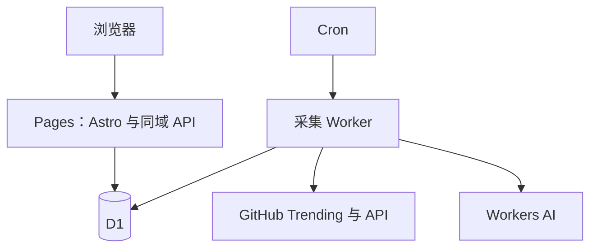

<div align="center">

# GitHub Discovery

**发现下一个值得关注的开源项目。**

中文解读 · 热门榜单 · 历史回看 · Rising 增长发现

[](https://github.com/chenran71ran-oss/github-discovery/actions/workflows/ci.yml)
[](LICENSE)
[](https://astro.build)
[](docs/deployment.md)

[访问网站](https://radar.chenran71ran.cc/) · [快速部署](docs/deployment.md) · [使用指南](docs/guide.md) · [反馈问题](https://github.com/chenran71ran-oss/github-discovery/issues)

</div>

---

GitHub Discovery 是面向中文用户的开源项目发现站。在 GitHub Trending 日／周／月榜单基础上，结合 README 中文解读、用途分类和实际增长样本，帮助你判断一个项目做什么、适合谁，以及为什么值得关注。

基于 **Softween Web Fork** 二次开发，并整合其 Mailer 采集器。一个仓库、两个 Cloudflare 部署，不需要 VPS、Docker 或本地常驻电脑。完整来源与许可证说明见[上游记录](UPSTREAM.md)。

> **当前状态 · 2026-10-11**：前端、采集 Worker 和 D1 已部署；前端可查询数据库。首次真实采集与 AI 摘要尚待验收，自定义域名最后确认状态为初始化中。详见[验证记录](docs/validation.md)。

## 功能

|    能力    | 使用体验                                        |
| :--------: | :---------------------------------------------- |
|  热门榜单  | 今日、本周、本月独立排名，保留跨榜重复项目      |
|  中文解读  | 从 README 提炼简介、适用场景、技术栈和关注点    |
| 发现与筛选 | 日期、语言、用途、关键词与排序组合使用          |
|   Rising   | 根据约 24 小时实际 Star / Fork 样本发现增长项目 |
|  项目详情  | 查看 README 文本、项目指标与 Star 历史          |
|  个人收藏  | 本地收藏、已读标记、隐藏已读、JSON 导入导出     |
|  多端浏览  | 桌面卡片与列表、移动单列、浅色与深色主题        |
|  后台更新  | 定时采集、摘要缓存、备用源与失败保留旧榜        |

## 快速开始

需要 **Node.js 22+**。以下命令仅初始化本地数据库：

```bash
git clone https://github.com/chenran71ran-oss/github-discovery.git
cd github-discovery
npm ci
npm run db:local
npm run dev
```

可选：运行 `npm run seed -- --demo` 填入明确标注的本地演示数据。全新数据库没有榜单时，页面会显示等待采集。

生产部署请按照[Cloudflare 网页部署指南](docs/deployment.md)操作：初始化 D1 → 部署 Pages → 部署采集 Worker → 验证首次采集。

> Fork 后请替换根目录与 `worker/` 下两份 `wrangler.jsonc` 中的 D1 名称和 ID。仓库现有配置属于本站。

## 架构



浏览请求只查询已存储的数据；抓取与 AI 解读在后台执行。Pages 使用 Astro SSR 和同域 API，当前不是纯静态 HTML 导出。

|             目录             | 职责                                            |
| :--------------------------: | :---------------------------------------------- |
|        [`src/`](src/)        | 网站界面、项目详情与查询 API                    |
|     [`worker/`](worker/)     | Trending 抓取、GitHub 元数据、AI 摘要与定时任务 |
|     [`shared/`](shared/)     | 前后端共用的数据定义与校验                      |
| [`migrations/`](migrations/) | D1 表结构与迁移                                 |
|      [`tests/`](tests/)      | 采集、数据一致性与接口规则测试                  |
|       [`docs/`](docs/)       | 部署、使用、数据口径与验证说明                  |

## 文档

- [使用指南与数据口径](docs/guide.md)：筛选、收藏、Rising 算法与功能边界。
- [Cloudflare 网页部署](docs/deployment.md)：按控制台字段填写，无需本地部署。
- [常见问题](docs/faq.md)：空榜单、域名、密钥、数据更新与推送。
- [验证记录](docs/validation.md)：已通过的检查和仍待验证的线上环节。
- [贡献指南](CONTRIBUTING.md)：开发流程、改动边界与 PR 要求。
- [改动记录](CHANGELOG.md) · [路线图](docs/roadmap.md) · [上游来源](UPSTREAM.md)。

## 数据边界

Rising 仅覆盖本站跟踪的项目，指数表示近期关注增长，不代表项目质量。收藏保存在当前浏览器，不会自动跨设备同步。历史榜单保留当时指标，但项目解读使用最新摘要。AI 摘要可能有误，关键判断请核对原始 README。

## 开发验证

```bash
npm run check
npm test
npm run build
npx wrangler deploy --config worker/wrangler.jsonc --dry-run
```

## 致谢与许可

感谢 [Softween Web](https://github.com/Softween/softween-trending-web) 和 [Softween Mailer](https://github.com/Softween/softween-trending-mailer) 提供项目基础，以及相关项目带来的发现与交互思路。

源码采用 MIT 许可，保留[主项目许可证](LICENSE)与[采集器上游许可证](worker/LICENSE)。其他参考项目的使用方式见[来源记录](UPSTREAM.md)。
