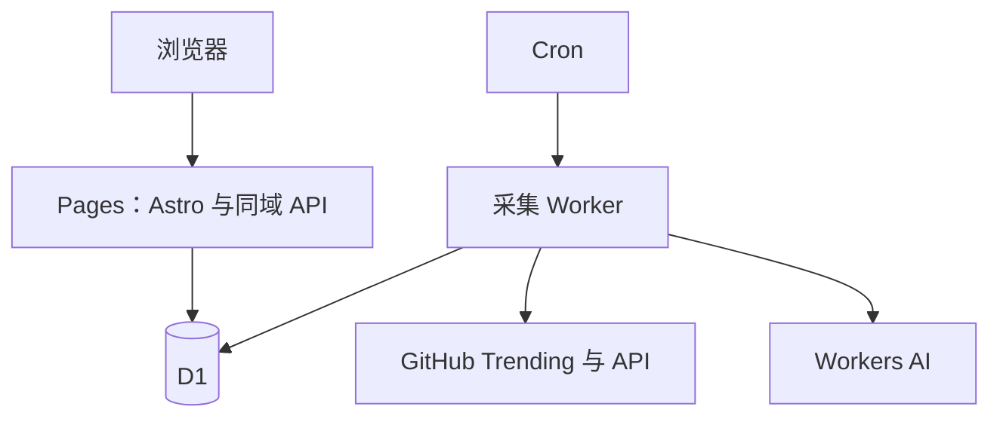

<div align="center">

## GitHub Discovery

发现下一个值得关注的开源项目。

中文解读 · 热门榜单 · 历史回看 · Rising 增长发现

[](https://github.com/chenran71ran-oss/github-discovery/actions/workflows/ci.yml)
[](LICENSE)
[](https://astro.build)
[](docs/deployment.md)

[访问网站](https://radar.chenran71ran.cc/) · [快速部署](docs/deployment.md) · [使用指南](docs/guide.md) · [反馈问题](https://github.com/chenran71ran-oss/github-discovery/issues)

</div>

---

GitHub Discovery 是面向中文用户的开源项目发现站。在 GitHub Trending 日／周／月榜单基础上，结合 README 中文解读、用途分类和实际增长样本，帮助你判断一个项目做什么、适合谁，以及为什么值得关注。

基于 **Softween Web Fork** 二次开发，并整合其 Mailer 采集器。一个仓库、两个 Cloudflare 部署，不需要 VPS、Docker 或本地常驻电脑。完整来源与许可证说明见[上游记录](UPSTREAM.md)。

> **当前状态 · 2026-10-11**：前端、采集 Worker 和 D1 已部署；前端可查询数据库。首次真实采集与 AI 摘要尚待验收，自定义域名最后确认状态为初始化中。详见[验证记录](docs/validation.md)。

### 为什么做这个项目

GitHub Trending 能告诉你哪些项目受到关注，但项目描述往往很短，README 又需要逐个打开阅读。这个站把榜单、中文解读、适用场景和增长信息放在一起，减少从“看到项目名”到“判断是否值得尝试”之间的步骤。

适合寻找 AI / Agent、自托管、Cloudflare、开发工具和其他有趣项目的用户，也适合希望 Fork 开源站点、在 Cloudflare 上维护个人发现入口的开发者。

### 功能概览

<table align="center">
  <thead>
    <tr>
      <th align="center">能力</th>
      <th align="left">使用体验</th>
    </tr>
  </thead>
  <tbody>
    <tr>
      <td align="center">热门榜单</td>
      <td align="left">今日、本周、本月独立排名，保留跨榜重复项目</td>
    </tr>
    <tr>
      <td align="center">中文解读</td>
      <td align="left">从 README 提炼简介、适用场景、技术栈和关注点</td>
    </tr>
    <tr>
      <td align="center">发现与筛选</td>
      <td align="left">日期、语言、用途、关键词与排序组合使用</td>
    </tr>
    <tr>
      <td align="center">Rising</td>
      <td align="left">根据约 24 小时实际 Star / Fork 样本发现增长项目</td>
    </tr>
    <tr>
      <td align="center">项目详情</td>
      <td align="left">查看 README 文本、项目指标与 Star 历史</td>
    </tr>
    <tr>
      <td align="center">个人收藏</td>
      <td align="left">本地收藏、已读标记、隐藏已读、JSON 导入导出</td>
    </tr>
    <tr>
      <td align="center">多端浏览</td>
      <td align="left">桌面卡片与列表、移动单列、浅色与深色主题</td>
    </tr>
    <tr>
      <td align="center">后台更新</td>
      <td align="left">定时采集、摘要缓存、备用源与失败保留旧榜</td>
    </tr>
  </tbody>
</table>

### 使用流程

1. **选择榜单**：从今日、本周、本月开始，查看对应周期的排名和新增 Star；切换历史日期可回看本站保存的榜单。
2. **缩小范围**：组合语言、用途分类与关键词筛选，再按需要调整排序。搜索包含项目名称、描述和技术栈等信息。
3. **理解项目**：阅读中文简介与适用场景，打开详情查看 README 文本、Star 历史，再进入 GitHub 核对安装方法和项目状态。
4. **管理发现**：收藏感兴趣的项目，标记已读或隐藏已读；通过 JSON 导出、导入迁移浏览器中的个人记录。
5. **观察增长**：数据积累后进入 Rising，查看真实样本区间内的增长；新部署时该榜单可能暂时为空。

### 中文解读包含什么

AI 依据项目 README 输出结构化信息：项目简介、适用场景、技术栈、关注点和用途分类。解读在后台分批生成，浏览页面不会即时调用模型。

README 未变化时可以复用已有摘要；生成失败时仍展示原始项目描述，并按重试间隔补齐。AI 内容用于辅助发现，实际功能、许可与安装要求请以原仓库为准。

### 本地快速开始

需要 **Node.js 22+**。以下命令仅初始化本地数据库：

```bash
git clone https://github.com/chenran71ran-oss/github-discovery.git
cd github-discovery
npm ci
npm run db:local
npm run dev
```

可选：运行 `npm run seed -- --demo` 填入明确标注的本地演示数据。全新数据库没有榜单时，页面会显示等待采集。

生产部署请按照[Cloudflare 网页部署指南](docs/deployment.md)操作：初始化 D1 → 部署 Pages → 部署采集 Worker → 验证首次采集。

> Fork 后请替换根目录与 `worker/` 下两份 `wrangler.jsonc` 中的 D1 名称和 ID。仓库现有配置属于本站。

### 部署到 Cloudflare

本仓库按 **一个共享 D1、一个前端 Pages、一个采集 Worker** 部署。前端和后端连接同一个仓库，但构建目录与命令不同。

<table align="center">
  <thead>
    <tr>
      <th align="center">部署对象</th>
      <th align="center">配置位置</th>
      <th align="left">工作内容</th>
    </tr>
  </thead>
  <tbody>
    <tr>
      <td align="center">Pages</td>
      <td align="center">根目录 <code>wrangler.jsonc</code></td>
      <td align="left">Astro 页面、详情和同域查询 API</td>
    </tr>
    <tr>
      <td align="center">采集 Worker</td>
      <td align="center"><code>worker/wrangler.jsonc</code></td>
      <td align="left">定时抓取、元数据采样和 AI 解读</td>
    </tr>
    <tr>
      <td align="center">D1</td>
      <td align="center"><code>migrations/0001_discovery.sql</code></td>
      <td align="left">仓库资料、榜单快照、增长样本与任务记录</td>
    </tr>
  </tbody>
</table>

部署时先创建 D1 并执行迁移，再部署 Pages 和 Worker。前端构建命令为 `npm run build`、输出目录为 `dist`；采集器 Path 为 `worker`，构建命令为 `npm --prefix .. ci`，部署命令为 `npm --prefix .. run worker:deploy`。

`GITHUB_TOKEN` 为可选运行时密钥，用于提高公开仓库 API 访问预算；`TRIGGER_SECRET` 仅用于受保护的手动采集接口。没有手动触发密钥也能运行 Cron。目前没有管理员后台或邮件推送。

完整的控制台字段、绑定、密钥和验收步骤见[部署指南](docs/deployment.md)。绑定自定义域名只需修改 Pages，采集 Worker 不需要同步更换域名。

### 系统架构



浏览请求只查询已存储的数据；抓取与 AI 解读在后台执行。Pages 使用 Astro SSR 和同域 API，当前不是纯静态 HTML 导出。

<table align="center">
  <thead>
    <tr>
      <th align="center">目录</th>
      <th align="left">职责</th>
    </tr>
  </thead>
  <tbody>
    <tr>
      <td align="center"><a href="src/"><code>src/</code></a></td>
      <td align="left">网站界面、项目详情与查询 API</td>
    </tr>
    <tr>
      <td align="center"><a href="worker/"><code>worker/</code></a></td>
      <td align="left">Trending 抓取、GitHub 元数据、AI 摘要与定时任务</td>
    </tr>
    <tr>
      <td align="center"><a href="shared/"><code>shared/</code></a></td>
      <td align="left">前后端共用的数据定义与校验</td>
    </tr>
    <tr>
      <td align="center"><a href="migrations/"><code>migrations/</code></a></td>
      <td align="left">D1 表结构与迁移</td>
    </tr>
    <tr>
      <td align="center"><a href="tests/"><code>tests/</code></a></td>
      <td align="left">采集、数据一致性与接口规则测试</td>
    </tr>
    <tr>
      <td align="center"><a href="docs/"><code>docs/</code></a></td>
      <td align="left">部署、使用、数据口径与验证说明</td>
    </tr>
  </tbody>
</table>

### 文档

- [使用指南与数据口径](docs/guide.md)：筛选、收藏、Rising 算法与功能边界。
- [Cloudflare 网页部署](docs/deployment.md)：按控制台字段填写，无需本地部署。
- [常见问题](docs/faq.md)：空榜单、域名、密钥、数据更新与推送。
- [验证记录](docs/validation.md)：已通过的检查和仍待验证的线上环节。
- [贡献指南](CONTRIBUTING.md)：开发流程、改动边界与 PR 要求。
- [改动记录](CHANGELOG.md) · [路线图](docs/roadmap.md) · [上游来源](UPSTREAM.md)。

### 榜单与增长的计算口径

GitHub Trending 的周期新增 Star 与 Rising 的实际样本增长是两种不同的数据。周榜或月榜的新增数不会直接充当 24 小时增长。

<table align="center">
  <thead>
    <tr>
      <th align="center">指标</th>
      <th align="left">含义与限制</th>
    </tr>
  </thead>
  <tbody>
    <tr>
      <td align="center">周期新增 Star</td>
      <td align="left">来自 Trending 对应日／周／月页面显示的新增值</td>
    </tr>
    <tr>
      <td align="center">Rising 增长</td>
      <td align="left">来自两个相隔 22–26 小时的 GitHub API 计数器样本，显示实际间隔</td>
    </tr>
    <tr>
      <td align="center">Rising 指数</td>
      <td align="left">归一化 Star 增量占 60%、增长率占 30%、Fork 增量占 10%，范围 0–100</td>
    </tr>
    <tr>
      <td align="center">历史榜单</td>
      <td align="left">展示保存时的榜单指标，中文解读使用项目最新摘要</td>
    </tr>
  </tbody>
</table>

Rising 只覆盖本站跟踪的项目，表示近期关注变化，不代表质量评分，也不等同于 GitHub 官方 Trending。默认每轮有 Token 时最多采样 24 个项目，未配置 Token 时预算更小。

### 更新频率与失败处理

<table align="center">
  <thead>
    <tr>
      <th align="center">任务</th>
      <th align="center">北京时间</th>
      <th align="left">作用</th>
    </tr>
  </thead>
  <tbody>
    <tr>
      <td align="center">榜单采集</td>
      <td align="center">每天 02:15、08:15、14:15、20:15</td>
      <td align="left">抓取三种周期榜单并补充项目元数据</td>
    </tr>
    <tr>
      <td align="center">摘要补齐</td>
      <td align="center">每小时第 45 分钟</td>
      <td align="left">默认每轮处理最多 6 个待解读项目</td>
    </tr>
  </tbody>
</table>

主抓取失败时尝试备用 JSON 数据源，并拒绝超过 36 小时的旧数据。各周期独立处理，失败周期保留此前成功榜单；D1 事务发布快照，任务锁减少并发运行造成的重复写入。列表查询最多缓存 60 秒，新数据可能稍后显示。

### 当前功能边界

- 收藏、已读与隐藏状态仅保存在当前浏览器；可通过 JSON 备份迁移，尚无账户登录或跨设备自动同步。
- 搜索范围是选定榜单或本地收藏，不是 GitHub 全库搜索。
- 历史摘要版本回放、自动历史清理和 ChatGPT 每日推送尚未实现。
- 部署成功仍需检查首次任务、真实榜单与 AI 输出；[验证记录](docs/validation.md)区分已确认事项和待验收环节。

### 开发验证

```bash
npm run check
npm test
npm run build
npx wrangler deploy --config worker/wrangler.jsonc --dry-run
```

### 致谢与许可

感谢 [Softween Web](https://github.com/Softween/softween-trending-web) 和 [Softween Mailer](https://github.com/Softween/softween-trending-mailer) 提供项目基础，以及相关项目带来的发现与交互思路。

源码采用 MIT 许可，保留[主项目许可证](LICENSE)与[采集器上游许可证](worker/LICENSE)。其他参考项目的使用方式见[来源记录](UPSTREAM.md)。
