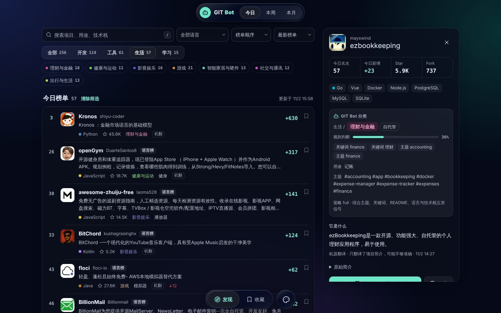
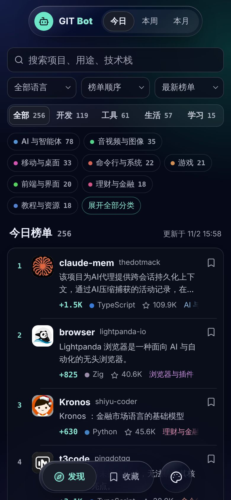
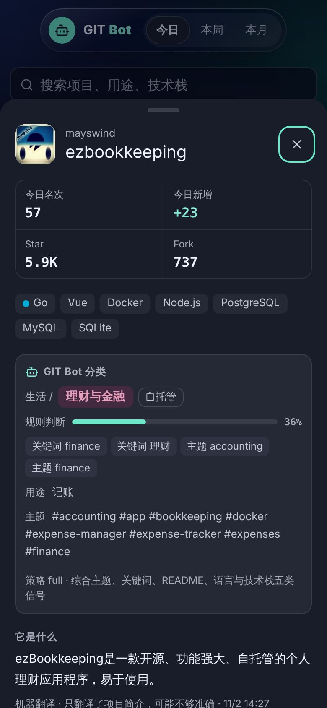
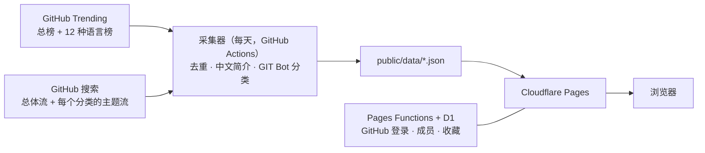

<div align="center">


# GIT Bot

**用中文发现 GitHub 上正在升温的开源项目——不只是 AI，还有工具和生活。**

[](https://github.com/chenran71ran-oss/github-discovery/actions/workflows/discovery-ci.yml)
[](https://github.com/chenran71ran-oss/github-discovery/actions/workflows/discovery-collect.yml)
[](https://radar.chenran71ran.cc/)
[](LICENSE)

[在线体验](https://radar.chenran71ran.cc/) · [功能](#-功能) · [GIT Bot 分类](#-git-bot-分类) · [工作原理](#-工作原理) · [快速开始](#-快速开始) · [自己部署](#-自己部署) · [路线图](#-路线图)



</div>

## 为什么做它

GitHub Trending 每页只有十几个项目，几乎都是 AI，全是英文，也看不出一个项目到底拿来干什么。想找一个好用的记账工具、一个自托管相册、一个健身 App，Trending 帮不上忙。

GIT Bot 每天从更多地方收集正在升温的项目，给每个项目配上中文简介，按「它是拿来做什么的」分好类，并告诉你为什么这样分。

## ✨ 功能

| | |
| :--- | :--- |
| 🔭 **更广的发现范围** | Trending 总榜、12 种语言榜，再加上 23 个分类各自的 GitHub 搜索流，专门找出很少登上总榜的工具类、生活类项目。一天约 560 个去重项目 |
| 🧠 **GIT Bot 分类引擎** | 4 个领域、23 个细类，综合主题、简介、README、语言和技术栈判断，**用途优先**；每个项目附带次要标签、置信度和判断依据 |
| 🈶 **诚实的中文** | 每段中文都标明来源：README 解读、上游速览、资料整理或「机翻」。不用模板凑内容 |
| 🔐 **仅限受邀成员** | 用 GitHub 登录，站长在网站里邀请、审批和停用成员；榜单数据同样需要登录 |
| ⭐ **收藏跟着账号走** | 收藏保存在账号里，换电脑、换手机都在；第一次登录自动导入浏览器里原有的收藏 |
| 🆕 **每天只看新的** | 所有项目都有增长数字（涨红跌绿，越热越红）；「首次上榜」标出今天新出现的项目，看过的变淡，可以只看没看过的 |
| ⌨️ **顺手的界面** | `/` 搜索，`J` `K` 切换，`S` 收藏；筛选条件写进网址可以直接分享；液态玻璃悬浮栏，深浅色一键切换，适配 iPhone |

<div align="center">
 &nbsp; 
</div>

## 🧠 GIT Bot 分类

| 领域 | 细类 |
| :--- | :--- |
| 开发 | AI 与智能体 · 开发工具 · 前端与界面 · 后端与 API · 数据与基础设施 · 安全与隐私 · 移动与桌面 · 游戏与图形 |
| 工具 | 效率与办公 · 命令行与系统 · 音视频与图像 · 浏览器与插件 · 自托管 · 自动化与爬虫 |
| 生活 | 理财与金融 · 健康与运动 · 影音娱乐 · 游戏 · 智能家居与硬件 · 社交与通讯 · 出行与生活 |
| 学习 | 教程与资源 · 科研与论文 |

「AI 修图工具」归到音视频与图像，再带上 AI 标签；Android 上的 VPN 归入安全与隐私。分类效果用人工标注的真实仓库衡量，在 60 个没有参与调参的仓库上：

| | 准确率 |
| :--- | :--- |
| 旧的关键词规则 | 28% |
| GIT Bot，主分类 | 53% |
| GIT Bot，主分类或次要标签 | 72% |

很多项目本来就跨类（比如「给编程智能体用的安全扫描」），所以界面同时展示次要标签和依据。分类体系只有一份 `shared/taxonomy.json`，前端和采集器共用；方法见 [ARCHITECTURE.md](docs/ARCHITECTURE.md#git-bot-分类引擎)。

## 🏗 工作原理



- **采集**：GitHub Actions 每天运行一次 Python 采集器，把榜单提交成 JSON；Cloudflare Pages 随之重新部署。任何一个来源失败都只跳过它本身，不会发布空站。
- **网站**：前端是静态页面；Pages Functions 拦在所有请求前面做登录检查，成员和收藏存在 D1。缺少配置时整站返回 503，不会不设防地放行。

**技术栈**：React 19 · TanStack Router / Query · UnoCSS · Vite · Cloudflare Pages Functions · D1 · Python

## 🚀 快速开始

需要 Node.js 24、pnpm 10.30.3；采集另需 Python 3.11+。

```bash
corepack pnpm install --frozen-lockfile
pnpm dev                      # 仓库里已有采集好的数据，打开即可；本地没有账号层，收藏存在浏览器
```

```bash
pip install -r collector/requirements.txt
python -m collector run       # 采集、中文增强、分类，写入 public/data/
python -m collector evaluate  # 在人工标注集上衡量分类效果
```

想在本地跑真实的登录与收藏（Workers 运行时 + 本地 D1），见 [运维手册](docs/OPERATIONS.md#账号与成员)。

## 🌐 自己部署

1. Fork 本仓库，在 Cloudflare Pages 新建项目并关联它：构建命令 `npx --yes pnpm@10.30.3 install --frozen-lockfile && npm run build:preview`，输出目录 `dist`，Node 24。
2. 新建一个 D1 数据库，在 Pages 项目里绑定为 `DB`（表会自动创建）。
3. 新建一个 GitHub App，Callback URL 填 `https://<你的域名>/api/auth/callback`。
4. 在 Pages 的 Production 环境添加 `GITHUB_CLIENT_ID`、`GITHUB_CLIENT_SECRET`、`SESSION_SECRET`（至少 32 位）、`ADMIN_GITHUB_LOGIN`（你的 GitHub 用户名），然后重新部署。
5. 打开网站用 GitHub 登录，你就是站长；在头像菜单 →「成员管理」里邀请朋友。

采集器由 `.github/workflows/discovery-collect.yml` 每天自动运行，可选的模型、翻译等配置见 [运维手册](docs/OPERATIONS.md#配置)。

## 📁 项目结构

采集器、前端和账号模块都按同样的四层组织，下层不依赖上层：

| 层 | 作用 | 采集器 `collector/` | 前端 | 账号 `edge/` |
| :--- | :--- | :--- | :--- | :--- |
| 类型与配置 | 数据结构、分类体系、常量 | `core/` | `shared/` | `types.ts` `config.ts` |
| 积木 | 可替换的模块与算法 | `blocks/` | `src/components/discovery/*.tsx` | `session.ts` `github.ts` `store.ts` |
| 实验 / 策略 | 组合成流程与规则，并衡量效果 | `lab/` | `model.ts` | `access.ts` `admin.ts` `favorites.ts` |
| 外交 | 配置、日志、调度、读写 | `app/` | `api.ts` | `http.ts` `pages.ts`、`functions/` |

## 🗺 路线图

- [x] 更广的采集范围：语言榜与分类搜索流
- [x] GIT Bot 分类引擎与标注集评估
- [x] GitHub 登录、受邀成员与管理员
- [x] 收藏同步到账号
- [ ] 「在 GitHub 上 Star」按钮
- [x] 所有项目的增长数字、涨红跌绿
- [x] 首次上榜标记、看过状态与「没看过」筛选
- [ ] 配置模型，为更多项目生成基于 README 的中文解读
- [ ] 独立的 Rising 排名算法与推送订阅

## ❓ 常见问题

<details>
<summary>打开网站显示「榜单暂时没有加载成功」？</summary>

多半是浏览器缓存里还是旧版页面。先打开 `/login` 登录，再按 Ctrl+Shift+R（Mac 为 Cmd+Shift+R）强制刷新。页面上的错误信息会附带 HTTP 状态和原因，例如 `missing DB（HTTP 503）` 表示部署环境缺少配置。
</details>

<details>
<summary>点「使用 GitHub 登录」后连接失败或 404？</summary>

连接失败说明当前网络打不开 github.com，需要先确保能访问 GitHub。404 通常是 `GITHUB_CLIENT_ID` 填错，或者 GitHub App 的 Callback URL 里没有当前网址的 `/api/auth/callback`。
</details>

<details>
<summary>站长能看到成员的收藏吗？</summary>

不能。收藏按 GitHub 账号隔离，接口只返回当前登录者自己的收藏；移除成员时其收藏一并删除。
</details>

## 📚 文档

| 文档 | 内容 |
| :--- | :--- |
| [ARCHITECTURE.md](docs/ARCHITECTURE.md) | 四层架构、数据流、分类引擎与评估、账号模块 |
| [DISCOVERY-UI.md](docs/DISCOVERY-UI.md) | 界面布局、交互、动效与验证记录 |
| [OPERATIONS.md](docs/OPERATIONS.md) | 运行状态、环境变量、自动采集、部署、账号配置与回滚 |
| [CONTRIBUTING.md](CONTRIBUTING.md) | 分支约定、合并前检查、模块边界 |
| [UPSTREAM.md](UPSTREAM.md) | 上游来源与改动说明 |

## 🤝 参与贡献

欢迎提 Issue 和 PR。分支命名为 `feat/`、`fix/`、`chore/`，合并前请跑一遍 [CONTRIBUTING.md](CONTRIBUTING.md#合并前检查) 里的检查；改分类词表时，留出集准确率不能下降。

## 致谢与许可

基于 [NewsNow](https://github.com/newsnext/newsnow)（MIT）二次开发，复用 [GithubTrending](https://github.com/Ibook000/GithubTrending)（Apache-2.0）的榜单解析器，中文速览部分来自 GithubTrending 每天发布的数据。两份许可都保留在仓库中（根目录 `LICENSE`、`collector/vendor/LICENSE`）。本项目不是 GitHub 平台上的正式 Fork，也不代表上游认可本项目，详见 [UPSTREAM.md](UPSTREAM.md)。
